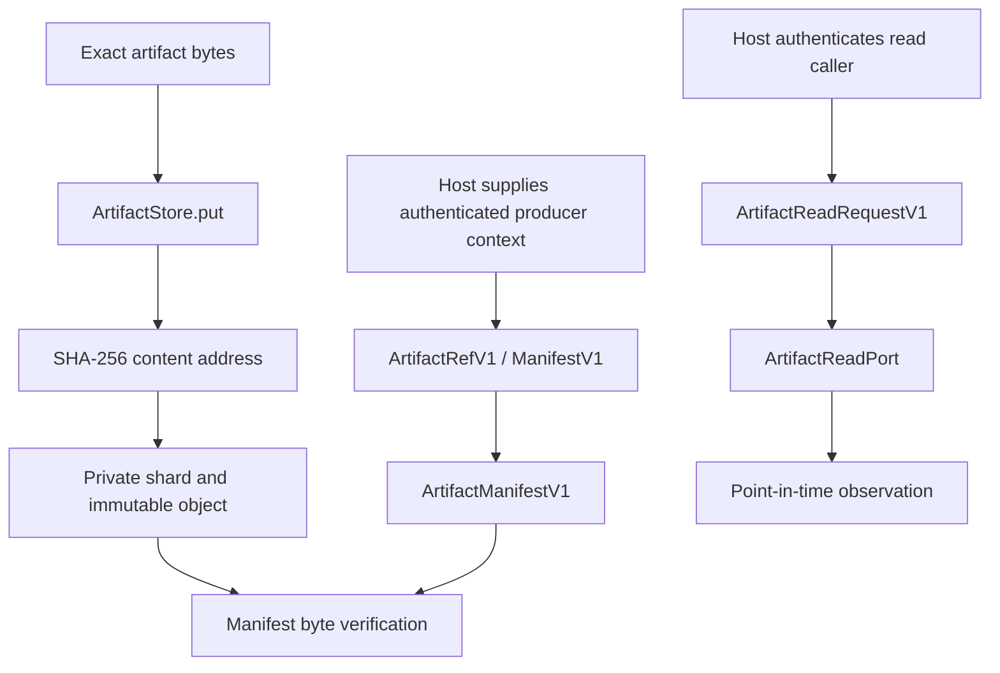

# Architecture

## Scope

`content-artifacts` is a local filesystem-backed content-addressed store plus typed artifact/manifest/read-observation contracts. It contains no database, network server, provider, session registry, or delivery worker.

The host owns identity authentication, authorization, trust evaluation, durable lifecycle state, and network transport.

## Module map

| Module | Responsibility |
|---|---|
| `lib.rs` | Private directory handling, content-addressed put/read, digest and media-type checks, manifest storage and byte verification. |
| `contracts.rs` | Versioned artifact/source/lineage/manifest structures and canonical serialization; session/ACL/delivery DTOs are retained as contracts only. |
| `read_port.rs` | Read request/result/observation contracts and local `ArtifactStore` read-port implementation. |

The upstream `sessions.rs` SQLite registry was excluded. No `rusqlite` dependency remains in this repository.

## Storage algorithm

1. Validate media type and 32 MiB bound.
2. Compute SHA-256 over exact input bytes.
3. Select a two-hex-character shard directory.
4. Create a unique staging file exclusively; on Unix request mode `0600`.
5. Write and sync exact bytes.
6. Publish with a hard link to the digest path; never replace an existing digest path.
7. On an existing path, read and compare exact bytes before treating the write as an idempotent repeat.
8. Read operations re-check reference shape, path type/containment, size, and digest.

The private root and shard directories are `0700` on Unix. The implementation uses path-based checks and is not resistant to every same-UID concurrent filesystem race; see [SECURITY.md](../SECURITY.md).

## Manifest semantics

`ArtifactRefV1` binds declared metadata to a lowercase SHA-256 digest and exact byte length. `ArtifactManifestV1` binds output artifacts to one producer/workflow/task/attempt/correlation tuple and records explicit parent artifacts. The store verifies local byte identity before persisting a canonical manifest.

These operations do not prove producer authenticity, upstream task success, manifest completeness, or external evidence truth. Hosts must authenticate producer identity and verify required lineage independently.

## Read-port semantics

`ArtifactReadPort` returns an `ArtifactReadResultV1` containing observation metadata and bytes only for `AVAILABLE`. Observation validation binds request ID, correlation ID, artifact identity, expected digest/size, supplied authenticated-source identity, observation ID, and observation time. The port itself does not authenticate or authorize the caller.

## Dependencies

Runtime dependencies are `hex`, `serde`, `serde_json`, `sha2`, `thiserror`, and `uuid`. There is no internal path dependency. `tempfile` is test-only.
